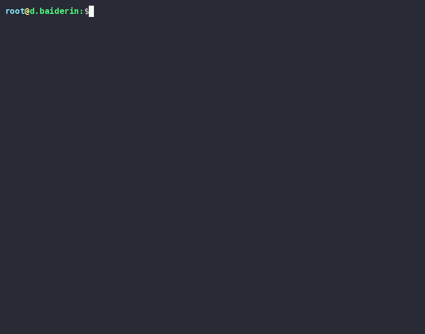

# Практическая работа: Настройка окружения и администрирование Linux

## 1. Настройка окружения

### Эмулятор терминала
* **Выбранный эмулятор:** **Алакритти**
* **Обоснование выбора:** Alacritty был выбран благодаря аппаратному ускорению отрисовки графики с помощью GPU (OpenGL), минимальному потреблению системных ресурсов и молниеносно

---

### Настройка приглашения командной строки (PS1)
Приглашение командной строки настроено в формате `login@your-login-at-nsu:` с использованием трёх разных ANSI-цветов:

```баш
экспорт PS1="\[\e[1;36m\]\u\[\e[1;33m\]@\[\e[1;32m\]d.baiderin\[\e[0m\]:\$ "
```

* **Логин (`корень`):** Голубой / Голубой (`\е[1;36м`)
* **Символ `@`:** Желтый / Жёлтый (`\е[1;33м`)
* **Хост / Ваша часть (`д.байдерин:`):** Зеленый / Зелёный (`\е[1;32м`)

---

### Становка asciinema
Утилита записи терминала установлена через системный пакетный менеджер `пакман`:

```баш
pacman -S asciinema
```

---

## 2. Практические задания

### Задание 1. Работа с gtypist
Выполнено упражнение `С3` в тренажёре `типист`. На скринкасте зафиксированы финальные показатели скорости и точности печати.

* **Результаты:**
  * **Чистая скорость:** зафиксирована в итоговом окне упражнения
  * **Отрегулированная скорость:** зафиксирована в итоговом окне упражнения
  * **Процент ошибок (Коэффициент ошибок):** в пределах нормы прохождения упражнения


---

### Задание 2. Убийства в командной строке (clmystery)
Проведено расследование убийства в городе с помощью стандартных утилит анализа текста (`греп`, `сед`, `авк`, `резать`).

* **Идентификация убийцы:** **Джереми Бауэрс**
* **Проверка решения:**
  ```баш
  echo "Джереми Бауэрс" | md5sum | grep -q "0c1724948a35564917f411e1278d2ab6" && echo "ВЕРНО!"
  ```
  *Результат проверки:* `ПРАВИЛЬНО!`


---

### Задание 3. Мониторинг системы
Сняты ключевые метрики производительности виртуальной машины с помощью системных утилит:

```баш
# 1. Модель ЦП и число ядер
lscpu | grep -E 'Имя модели|CPU\(s\):'

# 2. Общий размер и свободная ОЗУ
бесплатно -h

# 3. Занятое/свободное место на дисках
дф -х /

# 4. Утилизация диЁка и IOPS
иостат -х 1 2

# 5. Скорость и утилизация сетевого интерфейса
ip -s ссылка
```


---

### Задание 4. Завиток-односстрастный
Написан однострочник Баш для мониторинга сетевых задержек при запросах к эндпоинту `https://storage.mds.yandex.net/ping`.

``` Практическая работа: Настройка окружения и администрирование Linux
 Становка asciinema
```

#### Структура вывода (6 полей в одну строку):
1. **Временная метка:** Unix-время запуска запроса (`дата +%s`)
2. **HTTP-код:** Код ответа сервера (`%{http_code}`)
3. **Время подключения:** Время установки TCP-соединения (`%{время_подключения}`)
4. **Time AppConnect:** Времия управления TLS/SSL-соединения (`%{time_appconnect}`)
5. **ТТФБ:** Время до первого байта (`%{время_началопередачи}`)
6. **Общее время:** Общее время выполнения запроса (`%{time_total}`)


---

### Задание 5. Работа с перф
Для обхода ограничений виртуализации понижен уровень доступа к счётчикам ядра и выполнено профилирование с событием `процессор-часы`:

```баш
# Настройка прав доступа к событиям ядра
sysctl -w ядро.perf_event_paranoid=-1

резать
perf record -e cpu-clock -g -- сон 3

).
отчет о производительнѾссти --stdio
отчет о произвестии --stdio | гола -n 30



---

### (*) Дполнительньньное за�аданое: Профаилинг zstd
Выполнена компиляция утилиты `зстд` из исходников с флагами отладки (`-г -О2 -фПИК`) и снят профиль нагрузки во время максимального сжатия энт�

```баш
# 1. Сборка zstd
git clone https://github.com/facebook/zstd.git && cd zstd
список CFLAGS="-g -O2 -fPIC" -j$(nproc)

# 2. Запуск сжатия в фоновом режиме
cat/dev/urandom | ./zstd -19 -f -T4 -v - -o out.zst &

# 3. Запись профиля процесса
perf record -e cpu-clock -g -p $(pgrep zstd) -- sleep 5

дф -х /
отчет о производительности --stdio | head -n 30
```

#### Результаты анализа профиля:
perf record -e cpu-clock -g -- сон 3
* **Доля нагрузки:** **40,00%** (Себя) / **90,00%** (Дети)
* **Файл исходных кодов:** `lib/compress/zstd_opt.c`
